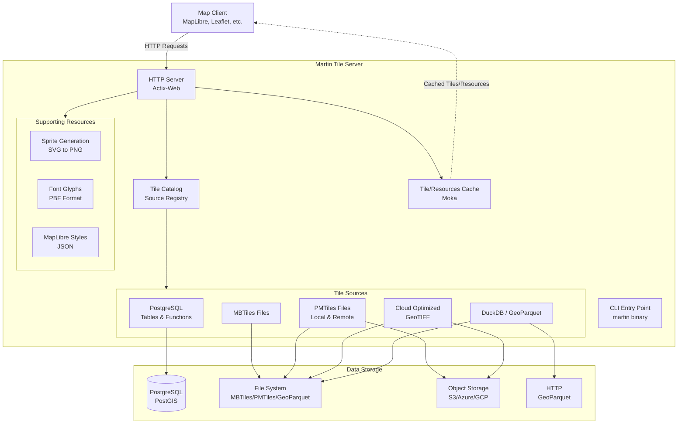

# Serving Architecture

How the Martin tile server is put together and how it answers requests.
[Source Architecture](architecture-sources.md) covers how each kind of source works and how sources reload at runtime,
and [Generation Architecture](architecture-generate.md) covers `martin cp --mode bulk`.

## Overview

Martin is a blazing fast tile server written in Rust that generates and serves vector tiles on the fly from multiple data sources.
It is designed to handle heavy traffic and optimize for speed while maintaining a clean separation of concerns.



## Crates

Martin's architecture is organized into five main Rust crates, each with distinct responsibilities:

=== "martin"

    **Purpose**: The main tile server binary and HTTP service layer.

    **Key Responsibilities**:

    - HTTP server using Actix-Web framework
    - Request routing and endpoint handling
    - Configuration parsing (CLI args, env vars, config files)
    - Tile source discovery and initialization
    - Runtime source reloading (filesystem watch / polling) without a restart
    - Serving the Web UI for tile inspection

=== "martin-core"

    **Purpose**: Core abstractions and implementations for tile sources and supporting resources.

    **Key Responsibilities**:

    - Abstract tile source traits and implementations
    - PostgreSQL connection pooling and query execution
    - MBTiles and PMTiles reading
    - Cloud Optimized GeoTIFF (COG) tile extraction
    - DuckDB / GeoParquet tile generation
    - Sprite, font, and style resource generation
    - Tile format handling (MVT protocol buffers)

=== "mbtiles"

    **Purpose**: MBTiles format support and manipulation tools.

    **Key Responsibilities**:

    - SQLite-based MBTiles reading and writing
    - Metadata management
    - Tile compression (gzip, brotli)
    - Validation and integrity checking
    - Diff/patch operations between MBTiles files
    - Schema management

=== "martin-tile-utils"

    **Purpose**: Low-level tile manipulation and conversion utilities.

    **Key Responsibilities**:

    - Tile coordinate system conversions
    - Tile encoding/decoding
    - Tile format utilities
    - Bounding box calculations

=== "martin-tilegen"

    **Purpose**: The bulk tile generation engine behind `martin cp --mode bulk`.

    **Key Responsibilities**:

    - Compiling layers and their CEL expressions into a plan
    - Rendering every feature at every zoom into tile pieces
    - Sorting the pieces on disk by tile, and merging them back
    - Encoding tiles in parallel and writing them in archive order

    See [Generation Architecture](architecture-generate.md).

## Requests and startup

=== "Tile requests"

    ```mermaid
    sequenceDiagram
        participant Client
        participant Server as HTTP Server
        participant Catalog
        participant Cache
        participant Source as Tile Source
        participant DB as Data Store

        Client->>Server: GET /source_id/z/x/y
        Server->>Catalog: Resolve source_id
        Catalog-->>Server: Source reference
        Server->>Cache: Check cache

        alt Tile in cache
            Cache-->>Server: Cached tile
            Server-->>Client: 200 OK (tile data)
        else Tile not in cache
            Server->>Source: Get tile(z, x, y)
            Source->>DB: Query data
            DB-->>Source: Raw data
            Source->>Source: Generate MVT
            Source-->>Server: Tile data
            Server->>Server: Postprocess (MLT, compress)
            Server->>Cache: Store postprocessed tile
            Server-->>Client: 200 OK (tile data)
        end
    ```

=== "Startup"

    ```mermaid
    sequenceDiagram
        participant CLI
        participant Config as Config Parser
        participant Discovery as Source Discovery
        participant Sources as Tile Sources
        participant Server as HTTP Server

        CLI->>Config: Parse args & config file
        Config->>Discovery: Initialize sources

        alt PostgreSQL Source
            Discovery->>Discovery: Connect to database
            Discovery->>Discovery: Query tables & functions
            Discovery->>Sources: Register table sources
            Discovery->>Sources: Register function sources
        end

        alt File Sources
            Discovery->>Discovery: Scan MBTiles files
            Discovery->>Discovery: Scan PMTiles files
            Discovery->>Sources: Register file sources
        end

        alt DuckDB Sources
            Discovery->>Discovery: Read duckdb.sources from config
            Discovery->>Discovery: Introspect GeoParquet metadata
            Discovery->>Discovery: Discover database tables & macros
            Discovery->>Sources: Register DuckDB sources
        end

        Sources-->>Server: Source catalog
        Server->>Server: Setup routes
        Server->>Server: Start HTTP listener
    ```

=== "Sprites and fonts"

    ```mermaid
    sequenceDiagram
        participant Client
        participant Server
        participant Sprite as Sprite Generator
        participant Font as Font Generator
        participant FS as File System

        Client->>Server: GET /sprite/sprite_id
        Server->>Sprite: Generate sprite
        Sprite->>FS: Read SVG files
        FS-->>Sprite: SVG data
        Sprite->>Sprite: Render to PNG
        Sprite->>Sprite: Generate JSON index
        Sprite-->>Server: Sprite sheet
        Server-->>Client: PNG/JSON response

        Client->>Server: GET /font/fontstack/range
        Server->>Font: Generate glyphs
        Font->>FS: Read font files
        FS-->>Font: Font data
        Font->>Font: Rasterize glyphs
        Font->>Font: Encode as PBF
        Font-->>Server: Glyph data
        Server-->>Client: PBF response
    ```

## Deployment

Martin supports multiple deployment patterns:

=== "Standalone"

    - Single binary with embedded WebUI
    - Direct PostgreSQL connection
    - Local file serving
    - Suitable for small to medium deployments

=== "Containers"

    - Docker image with all dependencies
    - Configuration via environment variables
    - Health check endpoints
    - Suitable for Kubernetes and container orchestrators

=== "AWS Lambda"

    - Lambda adapter for Actix-Web
    - Cold start optimization
    - Stateless operation
    - Suitable for sporadic traffic

=== "Reverse proxy"

    - NGINX or Apache fronting Martin
    - Additional caching layer
    - SSL termination
    - Load balancing across multiple Martin instances

## Performance

=== "PostgreSQL queries"

    - **Bottleneck**: Complex geometry queries on large tables
    - **Optimization**: Spatial indexes (GIST), connection pooling, query tuning

=== "Tile encoding"

    - **Bottleneck**: MVT encoding CPU time
    - **Optimization**: Tile caching, pre-generated MBTiles for static data

=== "Network"

    - **Bottleneck**: High tile request rate
    - **Optimization**: Async I/O, connection keep-alive, compression

=== "Memory"

    - **Bottleneck**: Large tile cache size
    - **Optimization**: LRU eviction, configurable cache size, streaming responses

<!-- New Tab Group -->

=== "Vertical scaling"

    - Increase CPU for faster tile generation
    - Increase memory for larger tile cache
    - Faster disk I/O for file sources

=== "Horizontal scaling"

    - Run multiple Martin instances behind load balancer
    - Each instance maintains its own cache
    - Shared PostgreSQL database with connection pooling
    - CDN for tile distribution

## Security

=== "Input validation"

    - All tile coordinates validated (z/x/y bounds)
    - SQL injection prevention through parameterized queries
    - Path traversal prevention for file sources
    - URL parsing with strict validation

=== "Database access"

    - Read-only database user recommended
    - Connection string security (avoid logging)
    - SSL/TLS support for PostgreSQL connections
    - Certificate validation for secure connections

=== "Network security"

    - CORS configuration for cross-origin requests
    - Rate limiting (via reverse proxy)
    - Authentication/authorization (via reverse proxy)
    - HTTPS termination (via reverse proxy)

## Extending Martin

=== "A new tile source"

    To add a new tile source type:

    1. Implement the `Source` trait in `martin-core`
    2. Add configuration parsing in `martin`
    3. Register source in the catalog
    4. Add integration tests

    Example source types that could be added:

    - Vector tile rendering from raster data
    - Integration with other spatial databases

=== "A new resource type"

    To add new resource endpoints:

    1. Implement resource generator in `martin-core`
    2. Add an HTTP handler in `martin`
    3. Add configuration support
    4. Update catalog/discovery

=== "Authentication"

    Martin doesn't include built-in auth, but supports:

    - Reverse proxy authentication (recommended)
    - Custom Actix-Web middleware
    - Token-based access control via proxy

## Monitoring

These are the current monitoring and observability options:

=== "Metrics"

    Martin exposes Prometheus metrics via `/_/metrics`:

    - HTTP request counters and histograms

    If you need more in-depth observability, we would be happy to review PRs that add additional metrics; the current implementation is intentionally minimal.

=== "Health checks"

    We allow health checks via `/health` and `/catalog` endpoints:

    - `/health` - Basic health check (HTTP 200)
    - `/catalog` - Source availability check

=== "Logging"

    - logging via `env_logger`
    - Configurable log levels
    - Request/response logging
