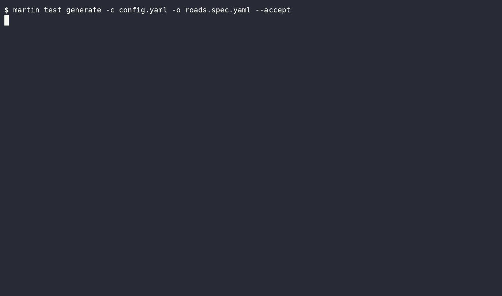
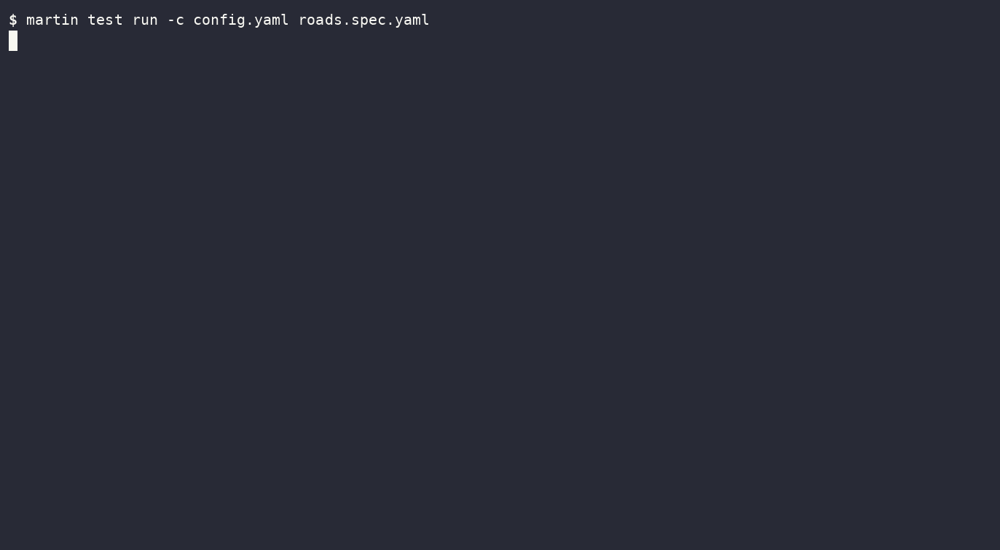
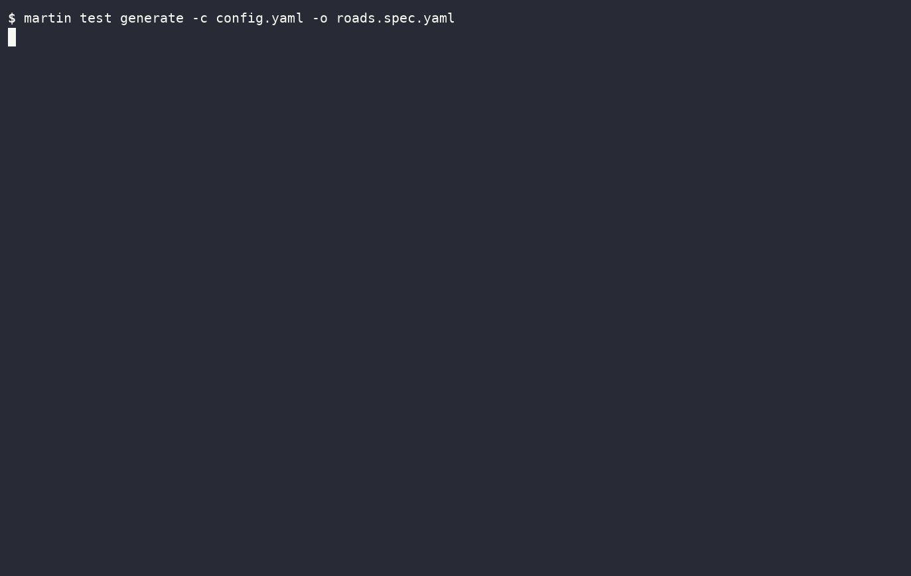

# Testing Layers

!!! warning "Not released"
    `martin test` is not in any release yet, and its spec file may still change.
    It is only built with the `unstable-generate` feature:

    ```bash
    cargo install --path martin --locked --features unstable-generate
    ```

`martin test` renders real rows through the [`layers`](sources-pg-layers.md) of table sources in
[bulk mode](martin-generate.md), and keeps the result in a spec file.

--8<-- "images/generate/test-overview.svg"

After a change to the layers, `run` shows how the spec's cases changed. Only `generate` finds rows for paths the
change added, so run it to cover them, and to update the spec.

## Usage

```bash
martin test generate --config config.yaml --output roads.spec.yaml
martin test run --config config.yaml roads.spec.yaml
```

Tests PostgreSQL table sources with `layers` and an `id_column`, from one `postgres` section.

```yaml
postgres:
  connection_string: postgres://postgres@localhost:5432/db
  tables:
    roads:
      schema: public
      table: roads
      srid: 4326
      geometry_column: geom
      geometry_type: LINESTRING
      id_column: id
      filter: "class IN ('primary', 'residential')"
      properties:
        id: int8
        class: text
        name: text
      layers:
        roads:
          minzoom: "class == 'primary' ? 6 : 12"
          attributes: [class]
        road_labels:
          minzoom: 12
          where: "name != null"
          attributes: [name]
```

## Paths

Paths are the distinct, interesting cases this configuration can produce.

--8<-- "images/generate/test-rows.svg"



A row on several paths is one case. `NO ROW`: no row takes the path.

Paths skip what the source or table rules out:

| Rule                                                   | Paths                                   |
|--------------------------------------------------------|-----------------------------------------|
| `filter` with `col IN (...)` or `col = ...`            | one per value, no `null` path           |
| `NOT NULL`, `PRIMARY KEY`                              | no `null` path                          |
| enum type, `CHECK (col IN (...))`, `CHECK (col = ...)` | one per value, `null` unless `NOT NULL` |
| `id_column`                                            | no `null` path                          |

None apply while a `jsonb` property column may replace the column.

`martin test` only selects rows with an `id_column` of 0 or more, so rows without one are never a case.

## Spec file

```yaml title="roads.spec.yaml"
max_zoom: 14
cases:
- source: roads
  paths:
  - "road_labels: dropped, `where: name != null` is false"
  - "roads: class 'residential' -> minzoom 12"
  input: # (1)!
    class: residential
    geometry: LINESTRING(16.34 48.22,16.341 48.221)
    id: 3
    name: null
  output: # (2)!
  - layer: roads
    id: 3
    geometry: line
    zooms: 12-14
    attributes:
      class: residential
```

1. The row's `id_column`, the columns the layers read, and its geometry as WKT. `run` reports `ROW CHANGED` when
   the row no longer matches.
2. What bulk mode writes: one entry per feature and layer, with its zooms and attributes.

## Running

After changing `minzoom` to `"class == 'primary' ? 7 : 12"`:



`run` exits with `0` when all cases pass, `1` otherwise, and `2` on an error.

## Generating

In a terminal, `generate` opens a review. `--accept` writes every case instead. Without a terminal, it
writes a new spec, or prints the diffs of an existing one and exits with `1`.
A `--max-zoom` other than the spec's cannot keep its cases as they are, so the review only writes once each
changed and gone case is accepted.


